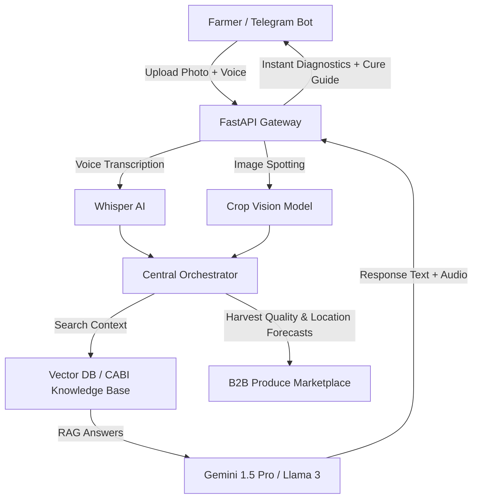

# 🌱 Gebere Vision AI (ገበሬ ቪዥን)
> **A Digital Agronomist in Every Farmer's Pocket — For Free.**

Gebere Vision AI is a zero-friction, voice-enabled, and image-based crop disease diagnostics bot designed for smallholder farmers in developing agricultural hubs (starting in Ethiopia). Operating over Telegram to bypass internet-bandwidth and app-install hurdles, it provides diagnostic reports and CABI-grounded remedies in under 30 seconds while simultaneously registry-mapping harvests to connect cooperatives directly to B2B buyers.

---

## 🚀 Core Value Proposition

* **Zero-Friction Engagement**: Operates entirely within Telegram — no app store downloads, updates, or accounts required.
* **Multilingual Voice Capabilities**: Integrated Whisper STT/TTS allows illiterate or semi-literate farmers to query in Amharic, Afaan Oromo, English, and Arabic via voice notes.
* **CABI Plantwise Grounded RAG**: Eliminates LLM hallucinations by restricting answers strictly to certified, peer-reviewed agronomic treatment databases.
* **Broker disintermediation Wedge**: Diagnostic coordinates and quality reports feed a B2B Produce Marketplace, helping cooperatives list verified quality harvests directly to millers and exporters.

---

## 🛠 Features & Architecture



### 1. Multimodal Vision Diagnostics
* Optimized to detect crop rusts, berry spots, and leaf blight lesions.
* Returns high-accuracy confidence scores.

### 2. Double-Shield Treatment Guides
* **Green (Organic/Cultural)**: Biological controls, crop rotation, and cultural prevention remedies.
* **Yellow (Chemical)**: Certified and restricted chemical controls (strictly adhering to local regulations).

### 3. Integrated B2B Trade Telemetry
* Integrates a cooperative dashboard to register produce batches.
* Includes automated moisture analysis calibration (under 13.5% safe-storage check).

---

## 📂 Tech Stack

* **Frontend Wrapper**: Next.js (Dashboard & B2B Web Platform)
* **Backend API Service**: FastAPI (Python)
* **AI & Vision Pipeline**:
  * Vision Models (Gemini Multimodal / custom fine-tuned Llama)
  * Speech Processing: Whisper STT & localized Speech-To-Text (Amharic & Afaan Oromo translations)
* **Grounding Database**: Pinecone / Qdrant Vector Store with CABI Plantwise documents

---

## 💻 Local Bot Setup & Development

Follow these steps to run the bot server script locally:

### 1. Prerequisites
* Python 3.10+
* A Telegram Bot token (obtained from [@BotFather](https://t.me/BotFather))

### 2. Environment Variables (`.env`)
Create a `.env` file in the root directory:
```env
TELEGRAM_BOT_TOKEN=your_bot_token_here
GEMINI_API_KEY=your_gemini_key_here
PINECONE_API_KEY=your_vector_db_key
FASTAPI_PORT=8000
```

### 3. Installation
```bash
# Clone the repository
git clone https://github.com/yourusername/gebere-vision-bot.git
cd gebere-vision-bot

# Create and activate virtual environment
python -m venv venv
source venv/bin/activate  # On Windows: venv\Scripts\activate

# Install dependencies
pip install -r requirements.txt
```

### 4. Run the Dev Engine
```bash
# Starts the FastAPI bot webhooks server
uvicorn main:app --reload --port 8000
```

---

## 📈 Roadmap

- [x] **Phase 1**: Regional pilot testing (3 cooperatives in Oromia, Ethiopia)
- [x] **Phase 2**: Launch of the B2B Produce Marketplace & Cooperative Registry Portal
- [ ] **Phase 3**: Voice synthesis expansion for Kenya (Swahili) & Uganda (Luganda)
- [ ] **Phase 4**: Satellite-based regional epidemic forecasting maps for insurance providers

---

## 👤 Author & Vision

* **Solo Founder**: Building applied computer vision diagnostics and Whisper-powered localized speech models to democratize agricultural intelligence.
* **Farming Roots & Applied ML**: Fusing local trust with state-of-the-art AI.
